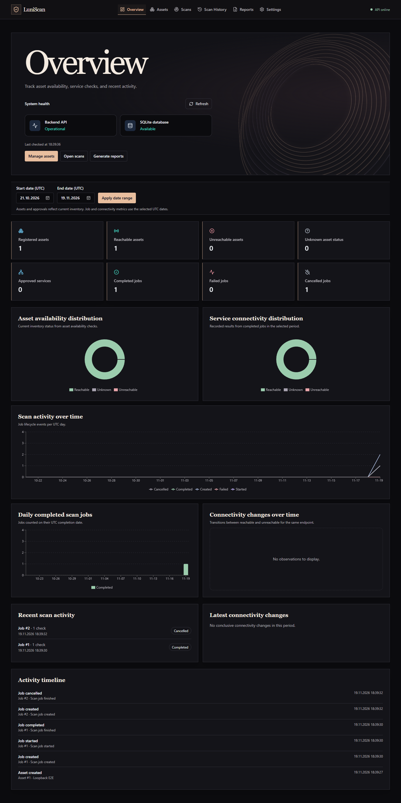
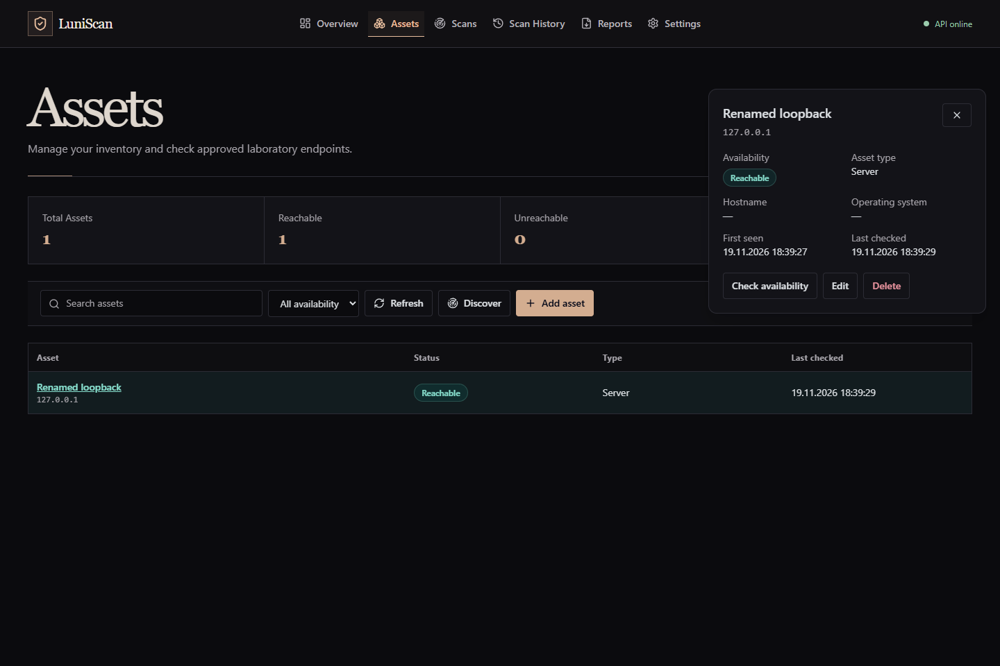

# LuniScan · Network Security Scanner

LuniScan is a local-first network asset inventory and security monitoring project for explicitly authorized networks and labs. It provides persistent inventory, user-initiated discovery, on-demand TCP monitoring, and operational dashboards and reports.

## Features

- FastAPI initializes a local SQLite database through SQLAlchemy at startup.
- The responsive React dashboard shows live API and database health. It refreshes every 30 seconds and supports manual refresh.
- Overview, Assets, Scans, Scan History, and Reports use the live API. Settings displays the active scope and validates IP literals against it.
- Asset records can include an optional group, tags, notes, and an operator-supplied OS. Discovery runs show per-target progress and retain completed observations.
- Local development uses a same-origin Vite proxy for API requests. Docker Compose publishes both services on loopback.

## Screenshots

Captured in Microsoft Edge against a disposable SQLite database and a local TCP listener.





[View the mobile Overview at 375px](docs/screenshots/overview-mobile.png)

## Architecture and stack

React, TypeScript, and Tailwind render the dashboard. Recharts displays aggregated observations. GSAP handles brief page transitions and respects reduced motion. Vite serves the frontend and proxies same-origin API requests to FastAPI. SQLAlchemy stores inventory, approvals, jobs, observations, and audit records in SQLite. ReportLab renders PDF reports. Pytest and Playwright cover API and Edge workflows.

~~~text
Edge → Vite → FastAPI → SQLAlchemy → SQLite
                  └── approved, rate-limited TCP checks
~~~

## Run on Windows 11

Install [uv](https://docs.astral.sh/uv/getting-started/installation/) and Node.js 22.12+ with npm. Open two PowerShell windows in the repository root.

In the first window, start the API.

```powershell
Set-Location backend
uv python install 3.12
Copy-Item .env.example .env
uv sync --locked --python 3.12
uv run --locked --python 3.12 uvicorn app.main:app --host 127.0.0.1 --port 8000 --reload --reload-dir app --no-access-log
```

In the second window, start the frontend.

```powershell
Set-Location frontend
Copy-Item .env.example .env
npm.cmd ci
npm.cmd run dev
```

Open <http://127.0.0.1:5173>. API documentation is available at <http://127.0.0.1:8000/docs>. Use `npm.cmd` in Windows PowerShell to avoid depending on the local script execution policy. Stop each server with Ctrl+C.

If health responds but application routes return 404, check that <http://127.0.0.1:8000/openapi.json> lists both methods on `/api/assets`. Stop an older backend running on that port and restart from the current `backend` folder. Set `LUNISCAN_API_PROXY_TARGET` to the backend origin without a path if you intentionally use a different port. To check a built frontend locally, run `npm.cmd run build` followed by `npm.cmd run preview` in `frontend`. Both commands that serve the frontend use the configured API proxy.

## Configuration

| Variable | Default | Purpose |
| --- | --- | --- |
| `LUNISCAN_DATABASE_URL` | `sqlite:///./luniscan.db` | Backend SQLite file URL. The relative path is resolved from the backend working directory. |
| `LUNISCAN_API_PROXY_TARGET` | `http://127.0.0.1:8000` | Vite server's upstream for `/api`. Restart Vite after changing it. |
| `LUNISCAN_APPROVED_SCOPE` | `["127.0.0.1","::1"]` | JSON array of approved IP literals and canonical CIDRs. Restart the API to apply changes. |
| `LUNISCAN_APPROVED_SERVICE_PORT` | `8443` | Single TCP port approved for every target in the configured scope. |
| `LUNISCAN_DISCOVERY_LIMIT` | `4` | Maximum IP addresses per request, configurable from 1 to 8. |

`GET /api/health` returns HTTP 200 with `{"status":"ok","database":"ok"}` when the database query succeeds. A database query failure returns HTTP 503 with `{"status":"degraded","database":"unavailable"}`. A database initialization failure stops API startup.

## Inventory and discovery

Use **Assets** to add, search, edit, or delete inventory records. Enter one group name, up to 20 tags, and optional notes. Filter by group, tag, type, or availability. Select an asset to see recent fixed-port observations, named service checks, related jobs, and observed changes. IPv4 and IPv6 literals are stored in canonical form. An IP change resets current availability and last-seen values while retaining recorded history. The last-seen time is updated only after a successful connection. Timestamps are stored in UTC and displayed in the browser's local time.

For a local check, start a TCP listener you control on port 8443, or configure the port of an existing authorized lab listener. Add `127.0.0.1` to the inventory and select **Check availability**. A successful TCP connection means the service endpoint was **reachable**. Connection refusal or timeout yields **unreachable**. Other socket failures yield **unknown**. An unchecked asset starts as **unknown**. Hostnames and operating systems are operator-supplied metadata. A result describes the configured endpoint at check time.

Use **Discover** to enter individual IP addresses, optionally validate the list, and confirm that you have permission to check every endpoint. The API validates the entire list before making a connection and revalidates each address before connecting. The panel shows committed results and lets you cancel remaining targets. If a connection was already admitted, it may finish within its timeout, but its result is discarded if cancellation commits first. Interrupted runs are marked failed on startup. Discovery creates records for endpoints that accept the connection and updates existing inventory observations. Newly discovered records use the IP as the display name and leave hostname and operating system empty.

Availability and scan observations include UTC check time, address, TCP port, outcome, error category, and elapsed probe time in milliseconds. Named checks include the approved service name. The duration excludes time spent waiting for the rate limiter. Historical rows with no measured duration or last-seen value remain empty. The application adds the new columns and tables on startup. Back up the SQLite file before upgrading.

### Authorized use

Configure the intersection of addresses you are explicitly authorized to check and the addresses you need. Supported scope entries are IPv4 loopback, RFC 1918 IPv4 private space, IPv6 loopback, and IPv6 unique-local space. Use the actual laboratory subnet boundaries and assigned unicast addresses. Public, link-local, and multicast addresses are excluded. The IP input accepts numeric literals only. Discovery requires an explicit target list and does not expand CIDRs. Checks open and close one TCP connection without sending application data or credentials.

Run the API with a single worker to keep the limit of one in-flight operation and at least one second between connection starts. Each connection times out after 750 ms. A competing operation or cooldown returns HTTP 429. This local development application has no user authentication. Keep it bound to loopback and use it only on a machine where local users are trusted.

### API routes

| Method and path | Purpose |
| --- | --- |
| `GET /api/assets`, `POST /api/assets` | List or create assets |
| `GET /api/assets/{id}`, `PUT /api/assets/{id}`, `DELETE /api/assets/{id}` | Read, replace editable fields, or delete an asset |
| `GET /api/scope`, `POST /api/scope/validate` | Read configured scope or validate `{"ip_address":"127.0.0.1"}` |
| `POST /api/assets/{id}/check` | Check an asset using an empty JSON object |
| `POST /api/discovery-jobs` | Submit an explicit `targets` array and `confirm_scope: true`. Returns the completed job. |
| `GET /api/discovery-jobs`, `GET /api/discovery-jobs/{id}` | Read the latest 50 completed jobs or one job by ID |
| `POST /api/discovery-runs` | Start a bounded, explicitly approved run and receive its ID |
| `GET /api/discovery-runs`, `GET /api/discovery-runs/{id}` | Read paginated run history or poll per-target progress |
| `POST /api/discovery-runs/{id}/cancel` | Cancel pending targets with an empty JSON object |
| `GET /api/assets/{id}/intelligence` | Read recent inventory observations, named service results, jobs, and connectivity changes |

`GET /api/assets` accepts optional `q`, `group`, `tag`, `asset_type`, `status`, `offset`, and `limit` parameters. The original unpaginated request and synchronous discovery routes remain available. Existing asset updates that omit the new metadata fields preserve their stored values.

Malformed payloads return 422, out-of-scope targets return 403, missing records return 404, and duplicate asset IP addresses return 409.

## Service monitoring and scan jobs

1. Open **Scans** and approve a service by entering its name and TCP port. Register a service only for endpoints you have permission to check. Revoke an approval from the service list when it is no longer needed.
2. Select registered assets and approved services, confirm permission for every resulting pair, and create a job. One job can contain up to eight assets, four services, and twelve checks.
3. Review the planned endpoints, confirm approval, and start the job. The job view shows progress, result counts, and committed checks. Pending and running jobs can be cancelled.
4. Open **Scan History** to search by asset, IP address, or service and filter by connectivity status. Select a result to compare it with the preceding completed check of the same asset address and service. The comparison describes observed connectivity and does not determine whether a vulnerability exists.
5. Use **Export JSON** or **Export CSV** in the completed job view. Exports include asset and job IDs, the service and port, status, UTC timestamp, and error category. CSV values that could be interpreted as formulas are prefixed with an apostrophe.

Job states, timestamps, endpoint snapshots, and results are stored in SQLite. The application logs lifecycle events and IDs without credentials. When a job is cancelled, committed results remain available in its details. A TCP connection already admitted may finish within its timeout, but its result is discarded if cancellation commits first. Jobs left running by an interrupted process are marked failed at the next startup. A new job requires explicit approval to retry those checks.

Use one backend process and a single worker. Jobs share the Phase 2 connection limiter with discovery and asset checks. They run sequentially with a 750 ms socket timeout and at least one second between connection starts. If a Phase 2 operation holds the connection slot when a job starts, the job records a `network_busy` failure. An asset address change or revoked service approval blocks the affected connection. All jobs are started manually.

### Service monitoring API

Interactive OpenAPI documentation is available at <http://127.0.0.1:8000/docs>.

| Method and path | Purpose |
| --- | --- |
| `GET /api/services`, `POST /api/services` | List service definitions or approve a `name` and integer `port` with `confirm_approval: true` |
| `DELETE /api/services/{id}` | Revoke approval. To reapprove, submit its original name and port again. |
| `GET /api/scan-jobs`, `POST /api/scan-jobs` | List the latest 50 jobs or create a pending job with `asset_ids`, `service_ids`, and `confirm_approval: true` |
| `GET /api/scan-jobs/{id}` | Read the job status, plan, progress, and committed results |
| `POST /api/scan-jobs/{id}/start` | Start a pending job with `confirm_approval: true`. Returns HTTP 202. |
| `POST /api/scan-jobs/{id}/cancel` | Cancel a pending or running job with `confirm_approval: true` |
| `GET /api/scan-history` | Read completed results, 50 per page. Filters include search, status, asset, service, and inclusive UTC dates. |
| `GET /api/scan-history/{result_id}/comparison` | Compare with the previous completed check for the same endpoint |
| `GET /api/scan-jobs/{id}/export/{format}` | Download completed results as `json` or `csv` |

## Service monitoring and TLS

Open **Service Monitoring → New profile** and select a registered asset. Approve its specific port and protocol, then save. TCP checks connect and close. For HTTP or HTTPS, choose a relative health path beginning with one slash, a status range, and optionally a non-sensitive UTF-8 response marker. Select the profile and click **Run manual check**. Disabling checks revokes execution without erasing history. Endpoint IP, port, and protocol are fixed for a profile so historical observations retain the same identity. Archive old profiles when replacing an endpoint.

The numeric approved address is passed directly to the socket. An optional hostname is used for HTTP Host and TLS SNI or name verification. HTTP redirects are recorded as degraded and never followed. Checks use no proxy or authentication, a 250–3,000 ms timeout, an 8 KiB content budget, a 16 KiB wire-read budget, and the same one-operation limiter as scans and discovery. No response bodies are retained or returned. Expected markers are write-only through the API.

HTTPS and TLS use the operating environment's default trust store and verify the endpoint name or IP. The verifier never retries without verification. Successful handshakes can report certificate details; rejected handshakes expose only the classification and verification time. Expiration thresholds default to 30 warning days and 7 critical days. Configure them through the backend environment. The dashboard displays the latest recorded certificate state. Days remaining refer to when it was inspected. HTTP status and certificate findings describe observations, not confirmed vulnerabilities.

The **Alert Center** records newly unreachable, degraded, repeated failure, certificate expiration, and verification events. Three consecutive non-healthy results trigger repeated failure. Acknowledgement records review. A later successful observation resolves a corresponding health condition, and a verified certificate observation resolves the applicable certificate conditions. One unresolved alert per profile and condition is kept. Alerts are local and check execution is manual.

| Method and path | Purpose |
| --- | --- |
| GET or POST /api/monitoring/profiles | List filtered profiles or register an approved endpoint |
| GET, PUT, or DELETE /api/monitoring/profiles/{id} | Inspect, edit, or archive one profile |
| POST /api/monitoring/profiles/{id}/check | Run one manual observation with an empty JSON object |
| GET /api/monitoring/profiles/{id}/history | Read paginated observations |
| GET /api/monitoring/summary | Read current counts and daily trends for the last 30 days |
| GET /api/monitoring/alerts | Filter alert history and current status |
| POST /api/monitoring/alerts/{id}/acknowledge | Acknowledge an alert with an empty JSON object |

Full and monitoring PDFs include health counts, HTTP observations, latest certificate states, and open alerts. Existing scan JSON and CSV exports retain their original purpose.

## Security configuration assessment

Open **Security Assessment**, select an asset and an enabled HTTP or HTTPS monitoring profile, confirm permission for that exact endpoint, and start. One bounded request uses the profile's approved numeric address, port, configured path, and default TLS verification. The assessor uses the shared connection limit and revalidates the destination immediately before dialing. No redirects are followed. The assessor uses response headers and TLS handshake data and does not save response bodies or arbitrary headers.

Supported HTTP checks cover HSTS, enforcing CSP, X-Content-Type-Options, Referrer-Policy, X-Frame-Options, and Permissions-Policy. HSTS is applicable to HTTPS. A restrictive CSP frame-ancestors directive can substitute for X-Frame-Options. CSP and framing findings are contextual review items, and the rules classify common directives rather than simulate a browser. TLS checks cover verifier outcome, expiry, and the version and cipher seen during normal negotiation. One negotiation cannot establish all server-supported settings. TLS warning days use the existing TLS warning threshold.

Informational findings identify controls to review. Low severity identifies a missing or weak defense. Medium identifies a transport or trust issue such as rejected certificate verification or an obsolete version observed during negotiation. The dashboard counts observed findings and incomplete rules separately. It assigns neither a CVSS score nor a probability of exploitation. Non-2xx responses do not establish application header coverage.

An acknowledgement records manual review. A later successful observation must demonstrate the same control before the finding is resolved. Inconclusive or inapplicable observations leave prior findings open. An assessment may finish with incomplete coverage. Cancelled and interrupted runs do not commit newly observed findings. Assessments are started on demand and never scheduled.

| Method and path | Purpose |
| --- | --- |
| POST or GET /api/security/assessments | Start one approved assessment or list paginated history |
| GET /api/security/assessments/{id} | Read execution status, coverage and observations |
| POST /api/security/assessments/{id}/cancel | Cancel a pending or running assessment with an empty JSON object |
| GET /api/security/assessments/{id}/export/{format} | Download a completed assessment as PDF, JSON or CSV |
| GET /api/security/findings | List findings with optional asset, severity, status and unresolved filters |
| GET /api/security/findings/{id} | Read finding details and its observation history |
| POST /api/security/findings/{id}/acknowledge | Record review with an empty JSON object |
| GET /api/security/summary | Read current counts and daily observations. Pass asset_id for one asset. |

The new SQLite tables are created on startup without replacing inventory or monitoring data. The asset detail panel shows recent assessments and remediation for unresolved findings. Completed exports contain only sanitized evidence.

## Dashboard, analytics, and reports

**Overview** combines backend health with inventory and service approval counts, job outcomes, recent jobs, and connectivity changes. The Recharts figures show asset availability, service connectivity, scan activity, completed jobs, and connectivity changes. Change counts compare consecutive completed checks for the same asset address revision and service. A prior check outside the selected period can establish the baseline. First observations and transitions involving unknown results are excluded from the change counts.

Date filters use inclusive UTC calendar dates and default to the last 30 days. A range may span up to 366 days. Inventory values and approved services are current snapshots. Job outcomes use the terminal timestamp. Charts use the timestamps of individual job events or completed-job check results. The timeline reads persisted job timestamps and connectivity changes. Asset creation and deletion appear only when an audit record exists. Existing assets are not backfilled into the audit log.

**Reports** offers full, asset inventory, and service monitoring PDFs. Full reports include all sections. Asset inventory reports focus on the current inventory and approved services. Service monitoring reports focus on approvals, completed check observations, and job history. Every report contains summary metrics, connectivity changes, UTC generation time, and monitoring limitations. The server renders one PDF at a time. Sections show up to 1,000 rows and identify truncation. Table headers repeat on later pages. The Reports page also links the existing JSON and CSV downloads for completed jobs in the latest 50 scan jobs.

| Method and path | Purpose |
| --- | --- |
| `GET /api/analytics/overview` | Return aggregate counts, daily series, recent jobs, and latest changes |
| `GET /api/analytics/timeline` | Return events newest first. Supports `offset` and `limit` up to 50. |
| `GET /api/reports/pdf` | Download `application/pdf`. Accepts `kind=full`, `inventory`, or `monitoring`. |

All three routes accept `start` and `end` in `YYYY-MM-DD` format. See the [interactive API documentation](http://127.0.0.1:8000/docs) for response schemas.

## Run with Docker Compose

Start Docker Desktop with Linux containers, then run from the repository root.

```powershell
docker compose up --build
```

Open <http://127.0.0.1:5173>. Compose serves the built frontend and stores SQLite data in the `luniscan-data` named volume. Use `docker compose down` to stop the services.

To override the scope, service port, or discovery limit in Compose, set the corresponding environment variables in the shell before starting the services. Loopback inside the backend container refers to that container.

## Verify the project

Run from the repository root after installing the dependencies.

```powershell
uv run --project backend --locked --python 3.12 pytest backend/tests
uv run --project backend --locked --python 3.12 ruff check backend
uv run --project backend --locked --python 3.12 python -m compileall -q backend/app backend/tests
npm.cmd --prefix frontend run build
npm.cmd --prefix frontend run test:e2e
npm.cmd --prefix frontend run test:e2e -- --preview
docker compose config --quiet
```

The Edge integration checks start isolated loopback services and use a disposable SQLite database. Install Microsoft Edge before running them.

Set LUNISCAN_TEST_OPENSSL to the local OpenSSL executable when running the Edge check to include the real self-signed TLS rejection scenario. Temporary certificate files are removed by the test.

## Known limitations

- The application is for a trusted local operator. It has no authentication or multi-user isolation. Run a single backend process with one worker and keep host bindings on loopback.
- Availability reflects a TCP connection at check time. Connectivity changes do not establish a vulnerability, and the interface does not infer a network topology.
- Reports may contain internal network inventory. PDF sections show up to 1,000 rows. Asset events are shown when stored audit records exist.
- Stop the Vite process before reinstalling dependencies in an existing Windows checkout. Native Node modules may remain locked while Vite is running.
- The current test client emits a Starlette deprecation warning for its httpx integration. npm may flag the esbuild install script while the platform package still supports the documented build.
- Docker runtime requires an active Linux container engine. CI and Docker runtime status must be verified in the deployment environment.

See [SECURITY.md](SECURITY.md) for reporting instructions, [CONTRIBUTING.md](CONTRIBUTING.md) for development guidance, and [CHANGELOG.md](CHANGELOG.md) for project history. LuniScan is available under the [MIT License](LICENSE).

## Repository layout

| Path | Contents |
| --- | --- |
| `backend/app/` | FastAPI, SQLAlchemy models, scope enforcement, analytics, and PDF reporting |
| `backend/tests/` | Health, inventory, scans, analytics, reports, and mocked network checks |
| `frontend/src/` | Dashboard, inventory, scan management, history, reports, API clients, and Tailwind styles |
| `compose.yaml` | Local container services and database volume |
